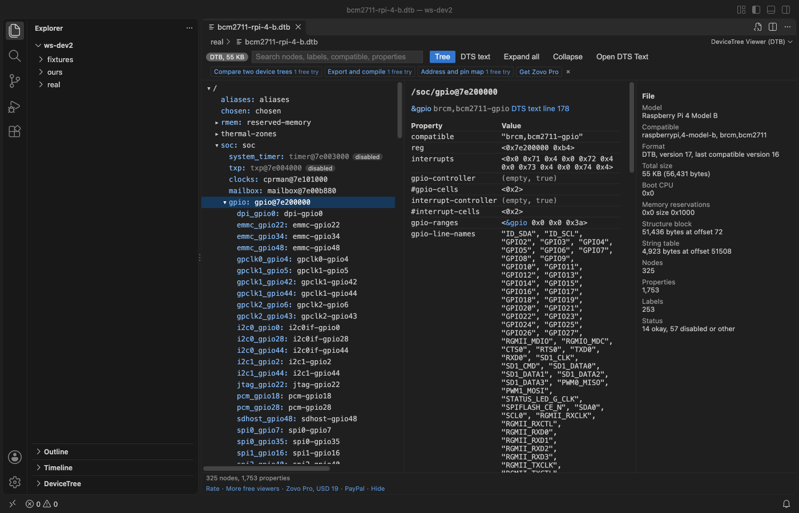

# DeviceTree Viewer, DTS & DTB

Open compiled device trees (.dtb, .dtbo) in VS Code as a node tree and as readable DTS text, and see .dts, .dtsi and Zephyr .overlay files as a tree. Made by Zovo.

Free, with no account and no network calls:

- Opens .dtb and .dtbo files (the binary Flattened Device Tree) as a node tree and as DTS text. Nothing else needs to be installed.
- A tree and property table for .dts, .dtsi and Zephyr .overlay files, through Open With or the DeviceTree view in the Explorer. Your text editor and language tools stay in charge of editing.
- Every property decoded: strings, cells and bytes; phandle references resolved to the node they point to (click to go there); reg read with the parent's #address-cells and #size-cells; interrupts grouped by the interrupt parent's #interrupt-cells; status okay or disabled at a glance.
- Labels from the __symbols__ node of a DTB, and overlay targets named through __fixups__.
- Search by node name, label, compatible string, property name or value.
- Header facts: version, boot CPU, memory reservations, structure and string table sizes, node, property and label counts.
- Click a DTS node's line link (or double-click the node) to jump to its line in the text; in a DTB it shows the node in the DTS text.

Zovo Pro: USD 19 once, for the Pro tools in every Zovo extension. Each Pro tool has 1 free try on your computer first:

- Compare two device trees: DTB with DTB, DTS with DTB, or board A with board B, matched by node path and property, not by text line. A reference counts by the node it points to, so different phandle numbers are not a change. Save the report as Markdown or HTML.
- Export and compile: save the tree as DTS, JSON or YAML, and compile a DTS file to a .dtb with the built-in device tree writer.
- Address and pin map: every reg range (as a CPU address through the parents' ranges), bus address, interrupt, GPIO and pinctrl entry in one sortable table. Overlapping address ranges, bus addresses used twice and GPIO pins used twice are flagged. Save it as CSV.

## How to use it

- Click a .dtb or .dtbo file in the Explorer. It opens in the viewer. Switch between Tree and DTS text in the toolbar; Open DTS Text puts the DTS in a read-only editor tab.
- For a .dts, .dtsi or .overlay file, right-click it and pick Open DeviceTree Viewer, or click the tree icon at the top right of its text editor.
- Once the extension runs in a window (after you open a device tree in the viewer or use one of its commands, or right away when a DTS language extension is installed), the DeviceTree view in the Explorer lists the nodes of the active .dts, .dtsi or .overlay file. Click a node to go to its line.
- Type in the search box to filter the tree. Enter goes to the next match.
- To try it without your own files, run DeviceTree: Open the Sample DTB (or Open the Sample DTS) from the Command Palette.
- The Pro tools are in the Command Palette (DeviceTree: ... (Pro)), in the Explorer right-click menu, in the viewer's title bar menu and in the small row at the end of the viewer toolbar. The row closes with its x for the rest of the session, and the setting `dtViewer.showProTools` hides the Pro tools for good.

## What a DTS file shows

The viewer reads one file at a time and does not run the C preprocessor. It lists the #include lines, keeps macro names such as `GPIO_ACTIVE_HIGH` as text, and shows `&label { ... };` blocks whose label comes from an included file as their own entries at the end of the tree. Blocks in the same file are merged into one tree, including /delete-node/ and /delete-property/.

Compiling to .dtb works for a complete tree in one file: macros must be defined in that file with #define, and every &label must be defined in it. Otherwise the export says which line needs what. A DTS saved from a DTB by this extension compiles back to the same tree.

## Files that are not device trees

A .dtb or .dtbo file that does not start with the device tree magic (0xd00dfeed) gets a short note, with buttons to open it in a hex editor (when one is installed) or as text. A cut or damaged file gets a note that says where it breaks. The viewer never switches the tab to another editor by itself.

## Privacy

The extension reads the file you open and nothing else. It makes no network calls, and nothing is uploaded or measured. The Pro tools write only the files you ask for. The links at the bottom of the viewer (Rate, More free tools, Zovo Pro) open a page only when you click them, and the setting `dtViewer.showSupportLinks` hides them.

## Settings

| Setting | Default | What it does |
|---|---|---|
| `dtViewer.showProTools` | true | Shows the Pro tools in menus, the palette and the toolbar row. |
| `dtViewer.showSupportLinks` | true | Shows the Rate, More free tools and Zovo Pro links. |
| `dtViewer.askForRating` | true | Asks once for a rating after two good uses at least 30 minutes apart. |

## Zovo Pro

One payment of USD 19 unlocks the Pro tools in every Zovo extension on your computers; a team of 5 is USD 59. The key works offline. Run Zovo Pro: Get Zovo Pro from the Command Palette. The Zovo Pro tab lists this extension's Pro tools and your free tries before any payment page opens.
